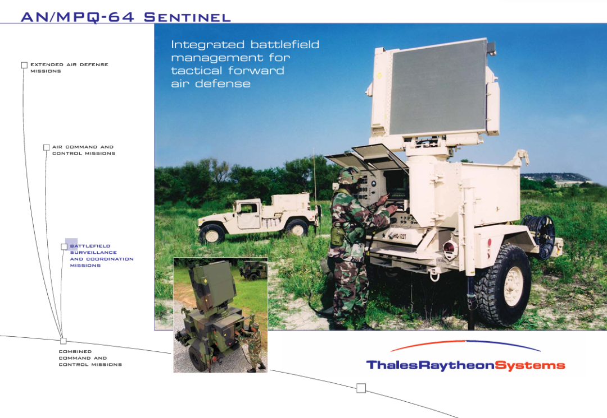
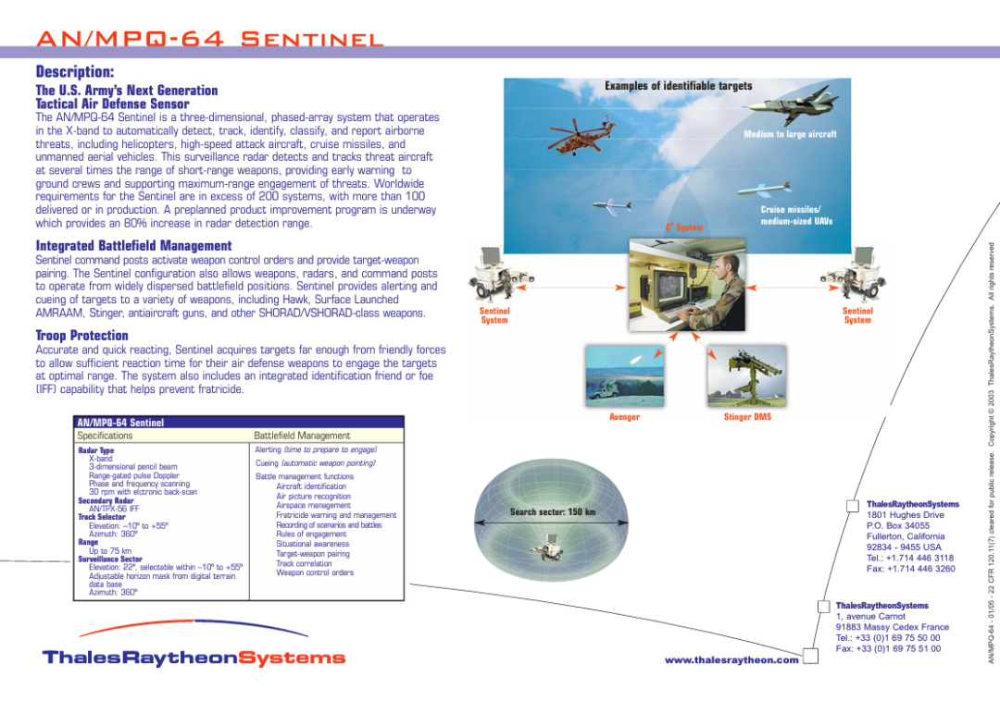
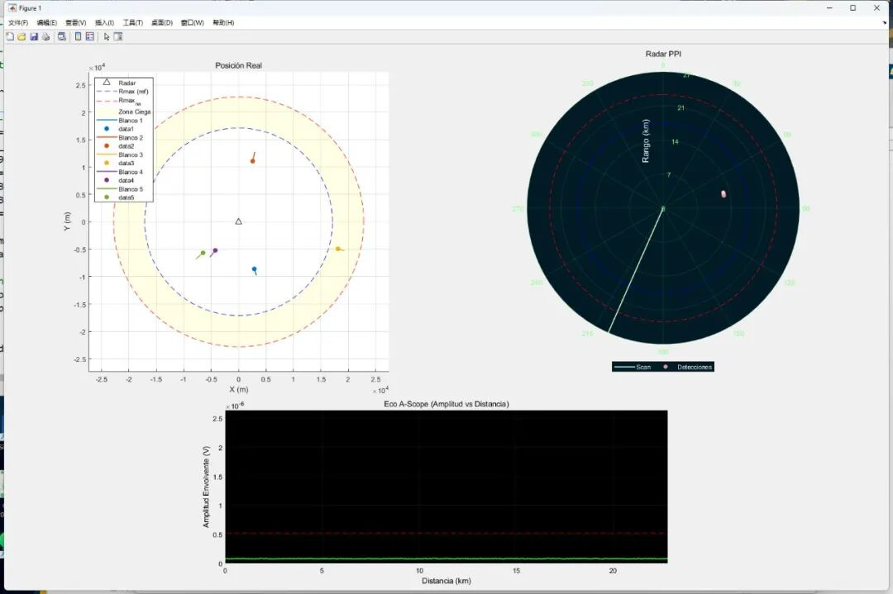

# [AN/MPQ] Simulation Project of Radar System at Autonomous University of Madrid: Reproducing the Core Functions of AN/MPQ-64 Sentinel  radar [with MATLAB]

I. Core Project Objectives: Focus on fundamental functions, recreate real detection scenarios. Unlike complex engineering-level radar systems, this project is positioned as an academic simulation. The core objective is to clearly present the basic working principles of pulse radar, while enhancing the scene's authenticity through detailed design:
1  
Functional simplification and focus: Not involving advanced technologies such as pulse compression, echo integration, adaptive detection, etc., only retaining the core process of "calculating maximum effective range - analog receiving signal - threshold contrast detection" to reduce the understanding barrier.
2  
Multi-object detection verification: Set 5 moving targets, each with its own initial position, movement direction and speed. Some of the targets are within the radar's maximum range, while others are outside. Observable phenomena such as "blind zone" and "distance ambiguity" can be observed directly.
3  
Target RCS Variation Introduction: Breaking away from the ideal assumption of "constant target radar cross section (RCS)", this study adopts the Swerling I/II model (first-order exponential distribution), allowing the instantaneous RCS of each target to vary randomly with pulses, closer to the dynamic differences in target reflection characteristics in real environments.
II. Key Parameters of the Radar System: Based on AN/MPQ-64 as a reference model, the simulation foundation project is precisely defined with the official parameters of AN/MPQ-64 Sentinel radar as the core, supplemented by data on similar radar performance, to establish the key technical indicators of the simulation system. This provides a precise basis for subsequent calculations and simulations. The following are the core parameter summaries:
Parameter category
Parameter Name
Numeric
Unit
Key role
Launch parameters
Peak power (Pd g)
10⁵  
W  
Decide the initial energy intensity of radar signal
Pulse width (τ)
1  
μs  
Influence of Resolution and Minimum Detection Distance
Working frequency (f)
9  
GHz  
Correlation with electromagnetic wave wavelengths, affecting propagation and reflection characteristics.
Antenna parameters
Antenna gain (Gant)
30 dB (1000 times)
-  
Enhanced Signal Transmission and Received Directivity
Antenna Beamwidth
3
Degree
Determines the instantaneous coverage angle range of a radar.
System Losses and Noise
System Loss (Ls)
5
dB
Incorporates various types of attenuation in signal transmission.
Noise Figure (Fn)
4
dB
Reflects the level of noise at the receiving end, affecting the sensitivity of signal detection.
System Temperature (T0)
290
K
The reference temperature for calculating thermal noise.
Target and Detection Requirements
Average RCS (σ)
1
m²
An average indicator of the target's ability to reflect radar signals.
False Alarm Probability (Pfa)
10⁻⁶
-
Controlling the probability of "falsely identifying an absence of targets as presence" to ensure detection reliability.
Detection Probability (Pd)
0.9
-
The correct detection probability when targets are present, reflecting the radar detection capability.
Core Theories and Simulation Process: From Theory Calculation to Dynamic Simulation, the project strictly follows radar principles, completing the entire process from "Theoretical Parameter Calculation - Target Movement Simulation - Signal Detection" step by step, with clear mathematical basis and implementation logic in each link.
1. Key Performance Parameters Calculation: Defining the "Radar Capability Boundary"•
Maximum Range of Action (Rmax): Based on the single-station radar basic formula, assuming the target RCS is constant (Swerling 0 model), combined with the minimum signal-to-noise ratio (SNRmin, calculated by shnidman function with Pd=0.9 and Pfa=10⁻⁶), the final result is Rmax=17.11 km, which is the farthest distance at which a radar can effectively detect a target;
•
Resolution of Distance and Minimum Detection Distance: Both are calculated by "speed of light × pulse width / 2", since the pulse width is 1μs, the final results are both 149.90 m - meaning that a radar cannot distinguish between two targets separated by less than 150m, nor can it detect targets with a distance less than 150m;
No ambiguity distance (Rmax,na) and pulse repetition frequency (PRF): To avoid "distance ambiguity" (i.e., radar misidentifying long-range targets as close ones), set Rmax = 3/4 × Rmax,na, resulting in Rmax,na = 22.81 km; further calculations yielded the pulse repetition interval (PRI = 0.1522 ms) and PRF (6571.02 Hz), ensuring unambiguous signal reception and processing.
2. Target Motion Simulation: The design of five target motion characteristics in dynamic detection scenarios fully considers "scene diversity," ensuring to cover different radar operating states:
•  
Initial Position Randomization: Polar coordinates are used for random generation, with a range of "Rmin + 0.3×Rmax,na" to "1.3×Rmax,na", which includes both the valid detection area and the far-distance area; the angle range is from 0 to 2π radians (uniform distribution).
•  
Fixed motion direction: All targets move towards the radar (origin of coordinates), simplifying trajectory analysis while observing the detection changes during the "from far to near" process.
•  
Speed Adaptive Adjustment: For distant targets (R > Rmax,na), the speed is set between 600-900 m/s; for close targets (R ≤ Rmax,na), the speed is set between 400-650 m/s. This ensures that distant targets have sufficient time to enter the effective detection area and maintain the dynamicity of the simulation.
3. Target RCS Realization: To simulate the dynamic changes of target RCS in real environments, the project uses MATLAB commands to generate random RCS values (based on the exponential distribution of average RCS) for each pulse cycle, thus making the echo power fluctuate with RCS fluctuations directly affecting detection probability. This design closely mirrors the reflective characteristics of actual targets such as aircraft and ships.
4. Visualization Interface: Four Screens in Unison, Effortlessly Displaying the Radar's Working State
The project has designed four core visualization interfaces to display the dynamic relationship between the radar and its target from different dimensions, facilitating real-time observation and analysis:
Interface Name
Location and Function
Key Information Display
Real-Position Screen
Upper left
The radar is fixed at the origin, displaying two concentric circles (representing Rmax and Rmax,na), with a yellow shadow area representing the "blind zone" (between Rmax and Rmax,na, with no effective detection); real-time drawing of the target's true trajectory allows observation of whether the target enters or leaves the valid zone / blind zone
PPI Screen (Plane Position Display)
Upper right
Polar projection, green scanning lines simulate the antenna rotating clockwise; only displays targets that are effectively detected (objects beyond Rmax,na will be displayed as "false close proximity" due to distance ambiguity), each echo retains only 1.5 scan cycles to avoid cluttered trajectories
A-Scope Screen (Distance - Amplitude Display)
Middle lower
The x-axis represents distance (km), the y-axis represents the echo amplitude; red dashed lines represent the detection threshold, peaks exceeding the threshold are considered valid target echoes, allowing for an intuitive observation of the relationship between echo intensity and distance, as well as the impact of noise on detection
Comprehensive Screen
Overall
Integrate the above three screens into a MATLAB subfigure layout to support simultaneous observation of "Target Real State - Radar Detection Results - Echo Signal Details," facilitating verification of detection accuracy (such as whether targets in the blind zone are not displayed, and whether blurred targets are positionally displaced)
V. Typical Detection Scenarios and Conclusions: Verifying the Radar Capabilities and Limitations
Through analyzing the dynamic detection process of five targets, this project summarizes six typical scenarios, clearly presenting the working characteristics and inherent limitations of pulse radar:
1. Effective Area Detection: When a target is within the "Rmin-Rmax" range and within the antenna beam, if the echo exceeds the threshold, both PPI and A-Scope can accurately display it;
2.
No detection in blind zone: When the target is located in the "Rmax-Rmax,na" blind zone, even within the beam, the system does not perform detection and there is no display on the interface.
3  
Super-blurry distance blur: when the target distance is greater than Rmax,na, the displayed distance is "actual distance mod Rmax,na", and a "falsely close proximity" appears.
4  
Initial detection within the beam: The target's initial position is within the effective area and within the beam, it can be detected as soon as the simulation starts.
5  
Overhead blind zone (R<Rmin): The target cannot be detected when it crosses the radar directly above (distance < 149.90 m), and the PPI trajectory will appear discontinuous, which will reappear after being far away.
6  
Long-range target restart: When the target distance exceeds "1.5× Initial Generated Distance", the system automatically assigns a new position and velocity (still towards the radar) to ensure there are always 5 active targets.
Conclusion: The simulation system can accurately reproduce the core functions of pulse radar. At the same time, it truly presents the inherent limitations such as "distance blur", "blind zone", "target fluctuation impact detection". Provides a high-value experimental platform for the teaching and preliminary research of radar principles.
VI. Project optimization: Solving technical difficulties. In the process of ensuring the stability of simulation, The team has proposed practical solutions to the issues of "data redundancy" and "visual misalignment." Ensure long-term stable operation of the simulation:
•  
Limit the amount of historical data: Each target's trajectory only retains the latest planned time step data, and old data is deleted to avoid excessive memory usage.
•  
Synchronous detection and real-time position display: Set the PPI echo display time to 1.5 scan cycles to eliminate the visual illusion of "detection and real-time position not synchronized".
•  
Movable legend: The legend of the real-location screen supports mouse dragging to avoid obscuring randomly generated targets.
•  
Simplified Track Points: Only display the recent track points of the target, avoiding long-term simulations where tracks overlap and become chaotic.
•  
Automatically Adjust Coordinate Axis: The real-position screen and PPI screen will automatically expand the coordinate axis according to the target's maximum distance, ensuring that the target does not exceed the field of view.
This project adopts the design philosophy of "simplifying without compromising" by transforming the complex principles of radar systems into intuitive simulation experiments. It is not only suitable for teaching demonstrations in radar-related fields at universities but also provides practical cases for radar technology enthusiasts to understand core concepts. For a deeper understanding, refer to the official documentation of AN/MPQ-64 Sentinel (https://www.radartutorial.eu/19.kartei/04.battle/pubs/mpq_64.pdf) or attempt to reproduce the core code based on MATLAB.
End

## Images

<!-- PAYMENT_BLOCK -->

## Get this dataset

- Payment link (Stripe): [Buy now](https://buy.stripe.com/3cs8yP7sY87d0vu9AB)
- Payment QR code: 

<!-- /PAYMENT_BLOCK -->
